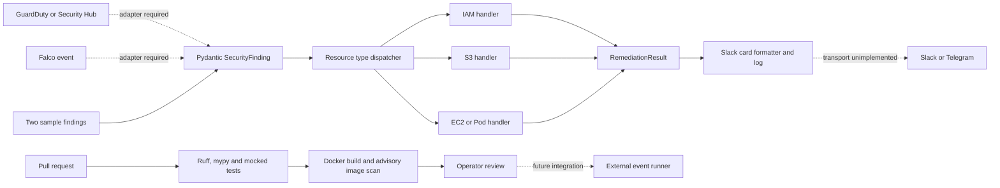

# Cloud Security Auto-Remediation

[](https://github.com/huy8114644/cloud-security-auto-remediation/actions/workflows/ci.yml)

A synchronous Python SOAR prototype that validates normalized findings, chooses handlers and formats incident cards. The local demo models IAM/S3 decisions without changing AWS. This is a library and sample runner, not a production webhook service.

## Architecture



CI enforces Ruff, mypy and mocked tests. Its Gitleaks command suppresses failures with `|| true`, and Trivy findings use advisory default exit behavior. A successful CI run does not establish that either security scan found no issues; the local `make scan` target fails on findings.

The separate scheduled `daily-remediation-simulation.yml` workflow runs the sample and still commits a digest with fixed processed/remediated counts and a compliance label. Those numbers are not measured AWS actions or validated compliance results.

## Scope and implementation limits

| Component | Current scope |
|---|---|
| `src/core/` | Pydantic models and synchronous dispatcher; no AsyncIO/event bus |
| `iam.py` | Injected client can call `update_access_key`; quarantine policy text is not an API call |
| `s3.py` | Injected client can block public access; encryption is described, not applied |
| `ec2_k8s.py` | EC2 example uses placeholder SG; Pod isolation/forensics are descriptive |
| `kms.py`, `rds.py` | Standalone examples, not registered by default dispatcher |
| `src/notifiers/` | Formats/logs Slack payloads; no network delivery |
| `tests/` | Mocked call, dispatch and formatting checks; no live AWS coverage |

Some handlers report non-dry-run success even without a client; result text is not proof of an AWS change. Do not use them for unattended response. Production integration still needs authenticated ingestion, approvals, idempotency, retries, scoped accounts/resources, durable audit storage, real transports and tested reversal playbooks.

## Local quickstart

Requires Python 3.11+ (CI 3.12), Make and optionally Docker. No cloud credentials or notification secrets are needed.

```bash
make setup
make lint typecheck test
make plan        # Two synthetic IAM/S3 findings with dry_run=True
make scan        # Gitleaks v8 required; missing CLI/findings fail
make build
docker run --rm --network none --read-only --cap-drop ALL cloud-soar-remediator:local
```

`make plan` runs the sample, not an AWS change plan; `make run-demo` is an alias. Tests report coverage without a percentage gate. Legacy `reports/` JSON contains fixed counts, not proven remediations.

## Configuration

No application environment variables are currently read by `src/`. Names such as `DRY_RUN`, `SLACK_WEBHOOK_URL` and `QUARANTINE_SECURITY_GROUP` are not implemented settings.

| Setting | Default | Purpose |
|---|---|---|
| `PYTHON` (Make) | `.venv/bin/python` | Interpreter/dependency environment |
| `IMAGE` (Make) | `cloud-soar-remediator:local` | Container build tag |
| `PYTHONUNBUFFERED` (image env) | `1` | Immediate output |
| `PYTHONDONTWRITEBYTECODE` (image env) | `1` | Avoid runtime bytecode writes |
| `dry_run` (Python constructor) | `False`; sample sets `True` | Prefer sample; do not infer safety from constructor defaults |

## Delivery and rollback

The supported delivery is the offline sample container. No Lambda handler, Kubernetes deployment or GitOps reconciliation is supplied. Implement missing safeguards before a sandbox integration, then mock success/failure and validate with scoped temporary credentials. Do not expose the prototype as an unauthenticated endpoint.

Revert faulty library/container code to its last reviewed version. This does not undo IAM/S3/EC2 changes: restoring keys, policies or security groups needs incident review and saved prior state.

## Contributions

See [CONTRIBUTING.md](CONTRIBUTING.md). Record the use case, tested SHA, CI link and remaining limits in real PRs. A passing mocked suite does not establish production readiness.
