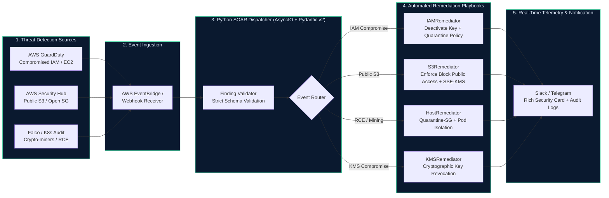

# Cloud Security Auto-Remediation (SOAR Engine)

[](https://github.com/huy8114644/cloud-security-auto-remediation/actions/workflows/ci.yml)
[](https://python.org)
[](https://pydantic.dev)
[](https://astral.sh/ruff)
[](LICENSE)

Production-grade **Cloud Security Orchestration, Automation, and Response (SOAR)** engine written in modern Python 3.12. Designed for automated, zero-human-delay threat containment across **AWS GuardDuty**, **AWS Security Hub**, and **Kubernetes Audit Logs**.

---

## 🎯 Problem Statement & Core Value

Average Mean Time to Remediate (MTTR) for compromised cloud credentials or public storage exposures often exceeds 30 minutes when relying on manual security triage. During this window, adversaries automate credential exfiltration, deploy cryptominers, or download sensitive proprietary data.

This engine provides an event-driven, automated response pipeline:
1. **Zero-Latency Ingestion:** Ingests alerts from AWS EventBridge, Security Hub, or Kubernetes Falco webhooks.
2. **Deterministic Pydantic v2 Validation:** Strongly validates alert payload structure with zero unhandled runtime exceptions.
3. **Automated Containment Playbooks:** Revokes compromised IAM credentials, enforces S3 Block Public Access, quarantines EC2/K8s workloads, and disables compromised KMS keys.
4. **ChatOps Telemetry:** Dispatches rich incident response cards to Slack and Telegram with full execution context and rollback guidance.

---

## 🏛️ Event-Driven SOAR Architecture



---

## 🛡️ Remediation Playbooks & MITRE ATT&CK Mapping

| Finding Type | Trigger / Source | MITRE ATT&CK | Automated Remediation Action |
|---|---|---|---|
| **Compromised IAM Key** | `UnauthorizedAccess:IAMUser/InstanceCredentialExfiltration` | T1552 - Unsecured Credentials | Deactivates Access Key via `UpdateAccessKey`, attaches inline quarantine deny policy |
| **Public S3 Bucket** | `S3.1 S3 Block Public Access` (Security Hub) | T1530 - Data from Cloud Storage | Enables all 4 S3 Block Public Access flags, enforces SSE-KMS encryption |
| **EC2 Cryptomining / C2** | `Trojan:EC2/DNSDataExfiltration` (GuardDuty) | T1496 - Resource Hijacking | Swaps active Security Groups with isolated `Quarantine-SG` (blocks all traffic) |
| **Kubernetes Pod RCE** | `Terminal shell in production container` (Falco) | T1059 - Command and Scripting | Applies Zero-Trust network isolation policy, isolates compromised pod |
| **Compromised KMS Key** | `UnauthorizedAccess:KMS/KeyCompromise` | T1552 - Cryptographic Secrets | Immediately disables key via `DisableKey` preventing unauthorized decryption |

---

## ⚙️ Environment Variables & Configuration

The SOAR engine is configured via standard environment variables:

| Variable | Type | Default | Description |
|---|---|---|---|
| `AWS_DEFAULT_REGION` | String | `us-east-1` | AWS region for Boto3 API remediation calls |
| `DRY_RUN` | Boolean | `true` | When true, simulates actions without modifying AWS resources |
| `SLACK_WEBHOOK_URL` | String | `null` | Webhook URL for Slack incident triage card notifications |
| `TELEGRAM_BOT_TOKEN` | String | `null` | Telegram Bot API token for security alerts |
| `TELEGRAM_CHAT_ID` | String | `null` | Telegram channel or group chat ID |
| `LOG_LEVEL` | String | `INFO` | Logging level (`DEBUG`, `INFO`, `WARNING`, `ERROR`) |

---

## 🚀 Local Developer Quickstart

Standardized operational tasks are automated via the included `Makefile`:

```bash
# 1. View all available Makefile commands
make help

# 2. Run Ruff linter and code style formatting check
make lint

# 3. Run Mypy static type verification (strict mode)
make typecheck

# 4. Run Pytest unit tests with coverage report
make test

# 5. Run Gitleaks secret detection scan
make scan

# 6. Execute sample dry-run remediation simulation
make run-demo
```

---

## 📦 Production Deployment (AWS Lambda / ECS Fargate)

The engine can be deployed as an event-driven AWS Lambda function or a continuous ECS Fargate container:

```bash
# Build hardened production container image
make build

# Deploy container to AWS ECR
aws ecr get-login-password --region us-east-1 | docker login --username AWS --password-stdin <ACCOUNT_ID>.dkr.ecr.us-east-1.amazonaws.com
docker tag cloud-soar-remediator:local <ACCOUNT_ID>.dkr.ecr.us-east-1.amazonaws.com/cloud-soar:latest
docker push <ACCOUNT_ID>.dkr.ecr.us-east-1.amazonaws.com/cloud-soar:latest
```

---

## 📄 License
This project is licensed under the MIT License - see the [LICENSE](LICENSE) file for details.
