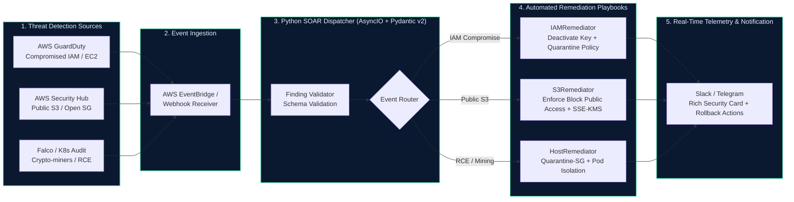

# Cloud Security Auto-Remediation (SOAR Engine)

[](https://github.com/huy8114644/cloud-security-auto-remediation/actions/workflows/ci.yml)
[](https://python.org)
[](https://pydantic.dev)
[](https://astral.sh/ruff)
[](LICENSE)

Production-grade **Cloud Security Orchestration, Automation, and Response (SOAR)** engine written in modern Python. Designed for automated zero-human-delay threat containment across **AWS GuardDuty**, **AWS Security Hub**, and **Kubernetes Audit Logs**.

---

## 🏛️ Event-Driven SOAR Architecture



---

## 🛡️ Remediation Playbooks & MITRE ATT&CK Mapping

| Finding Type | Trigger / Source | MITRE ATT&CK | Automated Remediation Action |
|---|---|---|---|
| **Compromised IAM Key** | `UnauthorizedAccess:IAMUser/InstanceCredentialExfiltration` | T1552 - Unsecured Credentials | Deactivates Access Key via `UpdateAccessKey`, attaches inline `QuarantineDenyAll` policy |
| **Public S3 Bucket** | `S3.1 S3 Block Public Access` (Security Hub) | T1530 - Data from Cloud Storage | Enables all 4 S3 Block Public Access flags, enforces SSE-KMS encryption |
| **EC2 Cryptomining / C2** | `Trojan:EC2/DNSDataExfiltration` (GuardDuty) | T1496 - Resource Hijacking | Swaps active Security Groups with isolated `Quarantine-SG` (blocks all egress/ingress) |
| **Kubernetes Pod RCE** | `Terminal shell in production container` (Falco) | T1059 - Command and Scripting | Applies Zero-Trust network isolation policy, triggers forensic snapshot memory dump |

---

## 🚀 Key Features

- **Pydantic v2 Type Safety:** Strict validation of incoming cloud events with zero runtime parsing errors.
- **Dry-Run Mode Supported:** Safe testing in staging environments (`DRY_RUN=True`) simulating remediation actions before production rollout.
- **Defense in Depth:** Zero external binary dependencies; runs inside a multi-stage non-root container (UID 10001).
- **Incident Response Telemetry:** Structured JSON audit logs and rich Slack/Telegram webhook integration.

---

## 🛠️ Local Development & Testing

```bash
# Install package with developer dependencies
pip install -e ".[dev]"

# Run Ruff linter and formatter
ruff check .
ruff format --check .

# Run static type analysis with mypy
mypy src/

# Run complete pytest test suite with coverage
pytest --cov=src --cov-report=term-missing tests/

# Execute sample remediation dry-run
python -m src.main
```

---

## 📄 License
This project is licensed under the MIT License - see the [LICENSE](LICENSE) file for details.

